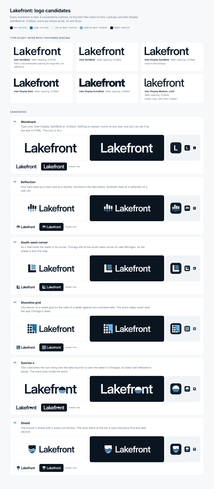
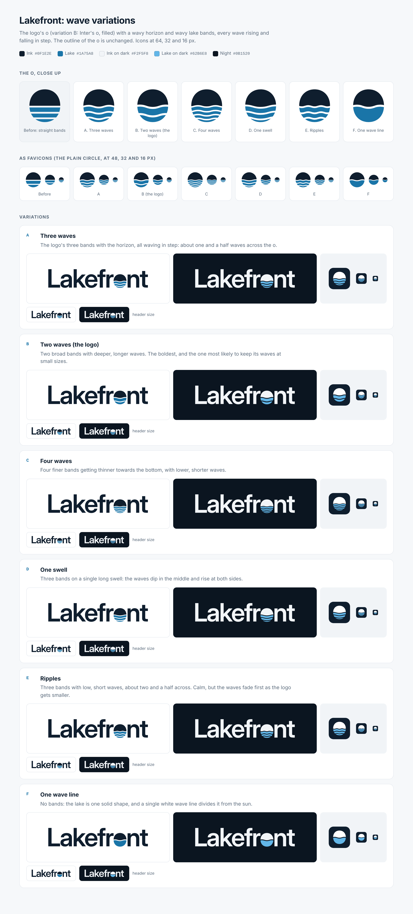

# Lakefront logo

## The logo


The wordmark is Inter Display SemiBold at -0.04em, converted to outlines. Its o is the sun rising over
the lake: Inter's own o, filled, navy above a wavy horizon and two broad, wavy lake-blue bands below, every
wave rising and falling in step (wave variation B, below). The favicon is a plain circle with the same
waves and no background; the website's home page draws its large sun from the favicon.

| File in [`logo/`](logo/) | Use |
|---|---|
| `lakefront-logo.svg` | The logo on light backgrounds |
| `lakefront-logo-dark.svg` | The logo on dark backgrounds |
| `favicon.svg` | Favicon for browsers that take SVG, drawn on a 32-unit grid; the website's hero sun uses its shapes |
| `favicon.ico` | The same at 16, 32 and 48 px, for everything else |
| `apple-touch-icon.png` | 180 x 180 home-screen icon. iOS needs an opaque square, so this one has a white background |
| `social-card.png` | 1200 x 630 image shown when a link to the website is shared |

```html
<link rel="icon" href="favicon.ico" sizes="16x16 32x32 48x48">
<link rel="icon" href="favicon.svg" type="image/svg+xml">
<link rel="apple-touch-icon" href="apple-touch-icon.png">
```

The favicon's top half is navy, which is hard to see on a dark browser tab bar.

To switch the logo with the reader's color scheme:

```html
<picture>
  <source srcset="lakefront-logo-dark.svg" media="(prefers-color-scheme: dark)">
  
</picture>
```

## How it was chosen

Six logo candidates, a type study of Inter with tightened spacing, and variations of the chosen
candidate. Open [`preview.html`](preview.html) in a browser to compare the candidates on light and dark
backgrounds and at icon sizes, or look at the picture below.



| # | Candidate | Idea |
|---|---|---|
| 01 | Wordmark | Type only: Inter Display SemiBold at -0.04em. Can be set as live text in HTML; the icon is its L. |
| 02 | Reflection | Four bars (a chart, a skyline) mirrored in the lake. Synthetic data as a reflection of a real city. |
| 03 | South-west corner | An L that holds the water in its corner. Chicago sits at the south-west corner of Lake Michigan. |
| 04 | Shoreline grid | City blocks on a street grid (or table cells) against one unbroken lake; the shore steps south-east, as Chicago's does. |
| 05 | Sunrise o | The o becomes the sun rising over the lake, its lower half reflected in bands. |
| 06 | Shield | An insurer's shield with a wave-cut horizon. The most literal. |

### Sunrise o variations

Candidate 05 was chosen. [`sunrise/`](sunrise/) refines it in two ways: the lake bands now run to the
bottom of the o, so it sits on the baseline like the letters around it (the first drawing stopped
short), and B to E follow the outline of Inter Display's own o, which is an oval about 51 x 54
units, not a 54-unit circle. Every o is solid, with no counter. Open
[`sunrise/preview.html`](sunrise/preview.html), or look at the picture below. Its first row traces
the outline of Inter's o over each version.


| | Variation | The o |
|---|---|---|
| A | Circle, three bands | The original circle, with the bands rebalanced to reach the bottom |
| B | Inter's o, three bands | Inter's outline of the o, filled in, with the same bands |
| C | Inter's o, four bands | Finer ripples; best large, as the gaps close up below about 24 px |
| D | Inter's o, two bands | Bolder; still works as a favicon |
| E | Inter's o, horizon only | Ink above the horizon, lake below; the quietest, and the clearest at small sizes |

### Wave variations

Sunrise variation B (straight bands) was the logo until the waves; wave variation B (two waves) replaced it. [`waves/`](waves/) tries waves in the lower half of the logo's o, keeping its outline (Inter's o, filled).
The bottom edge of the ink is a wave too, so the white line under the sun is wavy, and every wavy edge
shares one wavelength, height and phase: the waves rise and fall in step, and each white gap keeps its
width all the way across. The waves are centered on the o, so each version is symmetric. Open
[`waves/preview.html`](waves/preview.html), or look at the picture below. Its second row shows each
version in the favicon's plain circle at 48, 32 and 16 px.



| | Variation | The waves |
|---|---|---|
| A | Three waves | The logo's three bands and the horizon, about one and a half waves across |
| B | Two waves | Two broad bands with deeper, longer waves; the boldest |
| C | Four waves | Four finer bands getting thinner towards the bottom, with lower, shorter waves |
| D | One swell | Three bands on one long swell, dipping in the middle and rising at both sides |
| E | Ripples | Three bands with low, short waves, about two and a half across |
| F | One wave line | No bands: one solid lake under a single white wave line |

Waves need room: at header size (about 22 px tall) the finer ones (C and E) read as textured bands, and
at 16 px B, D and F keep their waves best. B was chosen and is the logo in [`logo/`](logo/)
(`LOGO_WAVES` in `make_logos.py`); each variation is an entry in the `WAVES` list: the bands (as the
sunrise bands), the wave height, wavelength and phase.

### Files

Each candidate in [`candidates/`](candidates/) has four SVG files:

| File | Use |
|---|---|
| `NN-name-lockup.svg` | Mark and wordmark, for light backgrounds |
| `NN-name-lockup-dark.svg` | The same for dark backgrounds |
| `NN-name-mark.svg` | The mark alone, 64 x 64 |
| `NN-name-icon.svg` | The mark on a rounded tile, for an app icon |

[`sunrise/`](sunrise/) has the same four files for each variation, named `a-...` to `e-...`, and
[`waves/`](waves/) the same, named `a-...` to `f-...`, plus a `-favicon.svg` (the plain 32-unit circle).
[`type-study/`](type-study/) holds the six wordmark settings shown at the top of the preview.

All text is converted to outlines, so the files need no font and render the same everywhere. The
colors are written into the files: Ink `#0F1E2E` and Lake `#1A75A8` on light backgrounds (Lake
passes 4.5:1 on white), `#F2F5F8` and `#62B6E8` on dark ones.

The candidates' icons are the full marks scaled down; the final favicon in `logo/` is drawn on the
pixel grid instead.

## Setting the wordmark as live text

If you would rather keep the logo as HTML text (candidate 01), this matches the SVG:

```css
.wordmark {
  font-family: "Inter Display", "Inter", system-ui, sans-serif;
  font-weight: 600;
  letter-spacing: -0.04em;
}
```

Inter 4 comes in two designs: Inter, for text, and Inter Display, drawn for large sizes with tighter
spacing and finer detail. The variable font combines them on an optical-size axis, so with Google
Fonts (`family=Inter:opsz,wght@14..32,100..900`) or InterVariable from rsms.me/inter you can use
`font-family: Inter` and `font-optical-sizing: auto`, and anything 32 px or larger is drawn in the
Display design. Set `letter-spacing` yourself either way: -0.04em is about twice what Inter's own
guidance suggests for large text (about -0.022em), which is what makes it read as a logo rather than a
heading.

## Rebuilding

```bash
pip install fonttools uharfbuzz resvg-py
```

```bash
python brand/make_logos.py --fonts /path/to/inter/otf
```

`make_logos.py` needs the Inter 4 OTF files from [rsms.me/inter](https://rsms.me/inter/) (both
`Inter-*.otf` and `InterDisplay-*.otf`). It sets the text with HarfBuzz so the font's kerning
applies, then writes every SVG, the three preview pages, and `logo/` (resvg renders its PNG and ICO
files). The wordmark used by the lockups, the palette and
each mark's geometry are near the top of the script; the sunrise variations are the `SUNRISE`
list, where each band is given in 28ths of the o's half-height below the horizon.
