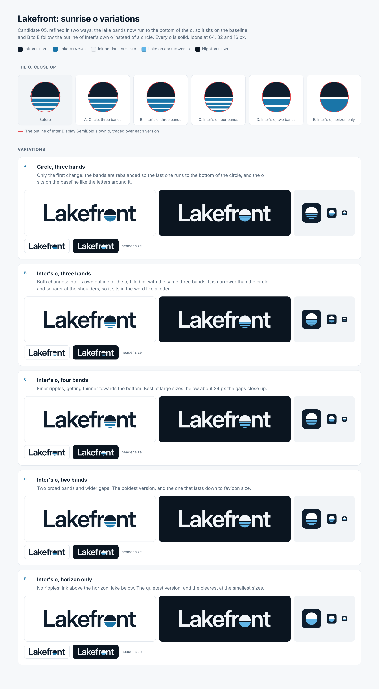

# Lakefront logo candidates

Six logo candidates for the dataset's website, plus a type study of Inter with tightened spacing.
Open [`preview.html`](preview.html) in a browser to compare them on light and dark backgrounds and at
icon sizes, or look at the picture below.


| # | Candidate | Idea |
|---|---|---|
| 01 | Wordmark | Type only: Inter Display SemiBold at -0.04em. Can be set as live text in HTML; the icon is its L. |
| 02 | Reflection | Four bars (a chart, a skyline) mirrored in the lake. Synthetic data as a reflection of a real city. |
| 03 | South-west corner | An L that holds the water in its corner. Chicago sits at the south-west corner of Lake Michigan. |
| 04 | Shoreline grid | City blocks on a street grid (or table cells) against one unbroken lake; the shore steps south-east, as Chicago's does. |
| 05 | Sunrise o | The o becomes the sun rising over the lake, its lower half reflected in bands. |
| 06 | Shield | An insurer's shield with a wave-cut horizon. The most literal. |

## Sunrise o variations

Candidate 05 was chosen. [`sunrise/`](sunrise/) refines it in two ways: the lake bands now run to the
bottom of the o, so it sits on the baseline like the letters around it (the first drawing stopped
short), and B to E follow the outline of Inter Display's own o, which is an oval about 51 x 54
units, not a 54-unit circle. Every o is solid, with no counter. Open
[`sunrise/preview.html`](sunrise/preview.html), or look at the picture below. Its first row traces
the outline of Inter's o over each version.



| | Variation | The o |
|---|---|---|
| A | Circle, three bands | The original circle, with the bands rebalanced to reach the bottom |
| B | Inter's o, three bands | Inter's outline of the o, filled in, with the same bands |
| C | Inter's o, four bands | Finer ripples; best large, as the gaps close up below about 24 px |
| D | Inter's o, two bands | Bolder; still works as a favicon |
| E | Inter's o, horizon only | Ink above the horizon, lake below; the quietest, and the clearest at small sizes |

## Files

Each candidate in [`candidates/`](candidates/) has four SVG files:

| File | Use |
|---|---|
| `NN-name-lockup.svg` | Mark and wordmark, for light backgrounds |
| `NN-name-lockup-dark.svg` | The same for dark backgrounds |
| `NN-name-mark.svg` | The mark alone, 64 x 64 |
| `NN-name-icon.svg` | The mark on a rounded tile, for a favicon or social card |

[`sunrise/`](sunrise/) has the same four files for each variation, named `a-...` to `e-...`.
[`type-study/`](type-study/) holds the six wordmark settings shown at the top of the preview.

All text is converted to outlines, so the files need no font and render the same everywhere. The
colours are written into the files: Ink `#0F1E2E` and Lake `#1A75A8` on light backgrounds (Lake
passes 4.5:1 on white), `#F2F5F8` and `#62B6E8` on dark ones.

The icons are the full marks scaled down. They hold up at 32 px; the chosen one will probably want
a simplified 16 px favicon drawn on the pixel grid.

## Setting the wordmark as live text

If you would rather keep the logo as HTML text (candidate 01), this matches the SVG:

```css
.wordmark {
  font-family: "Inter Display", "Inter", system-ui, sans-serif;
  font-weight: 600;
  letter-spacing: -0.04em;
}
```

Inter 4 comes in two designs: Inter, for text, and Inter Display, drawn for large sizes with tighter
spacing and finer detail. The variable font combines them on an optical-size axis, so with Google
Fonts (`family=Inter:opsz,wght@14..32,100..900`) or InterVariable from rsms.me/inter you can use
`font-family: Inter` and `font-optical-sizing: auto`, and anything 32 px or larger is drawn in the
Display design. Set `letter-spacing` yourself either way: -0.04em is about twice what Inter's own
guidance suggests for large text (about -0.022em), which is what makes it read as a logo rather than a
heading.

## Rebuilding

```bash
pip install fonttools uharfbuzz
```

```bash
python brand/make_logos.py --fonts /path/to/inter/otf
```

`make_logos.py` needs the Inter 4 OTF files from [rsms.me/inter](https://rsms.me/inter/) (both
`Inter-*.otf` and `InterDisplay-*.otf`). It sets the text with HarfBuzz so the font's kerning
applies, then writes every SVG and both preview pages. The wordmark used by the lockups, the palette and
each mark's geometry are near the top of the script; the sunrise variations are the `SUNRISE`
list, where each band is given in 28ths of the o's half-height below the horizon.
